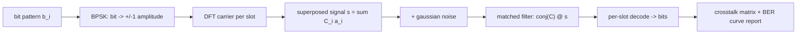

# 🌊 WAVE-CLASH

## 🎯 Interference spectroscopy for wave memories

Can you stack many messages into one wave signal and read them back?
WAVE-CLASH measures exactly that:

- 📡 **Crosstalk matrix** - how much slot i's decoder leaks from slot j's carrier
- 📊 **Noise curve** - bit error rate vs gaussian noise (honest numbers, no marketing)
- 🎲 **Fuzzed round-trip** - random bit patterns, superposed, decoded, compared

## 🔍 The honest finding

Perfectly orthogonal DFT carriers never clash - the crosstalk matrix is clean.
But add noise, and errors appear **measurably**: light noise survives,
heavy noise breaks the lattice. That honest curve is the whole point:
superposition is real, but it is not free. ⚖️

## 🚀 Quick Start

Requirements: Python 3.9+ and NumPy. CPU-only, seconds per run.

    git clone https://github.com/kapildhinwa2010-dev/WAVE-CLASH.git
    cd WAVE-CLASH
    pip install -e .

    python wave_clash.py --slots 8 --sigmas 0.01,0.1,0.5,1.0

## 🗺️ How the pipeline flows

## 💻 Usage

    python wave_clash.py --slots 8 --sigmas 0.01,0.1,0.5,1.0

Output: console JSON + `wave_clash_report.json`.

Library:

    from wave_clash import carriers, encode, decode, noise_report

## 🧪 Tests

    pytest -q

🔬 Honest limitations

- DFT carriers are exactly orthogonal in floating point here; real learned
  lattices are not, and clash harder.
- Gaussian noise is a simple adversary; real channels add phase drift and
  quantization error (future work: payload-level error correction).

## ⚖️ License

MIT - see [LICENSE](LICENSE).
